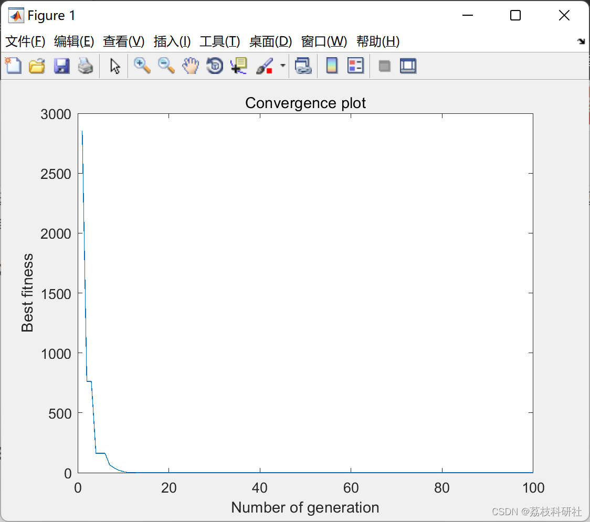

# [Improved Genetic Algorithm] Real-coded Genetic Algorithm with FFS Improvement (RGA) (Matlab Code Implementation)

Edit:

2. Running Results
Part of the code:
clear all; close all; clc; format short g; 
tic 
global CostFunction 
d=4; % Number of variables 
CostFunction = @(x) Sphere(x); % Function allocation 
xmin=[-100 -100 -100 -100]; % Lower boundaries of variables 
xmax=[100 100 100 100]; % Upper boundaries of variables 

This code is part of a larger script that uses the genetic algorithm (GA) to solve optimization problems. The GA is one of the most popular optimization techniques, consisting mainly of three evolutionary operators: selection, crossover, and mutation. The selection process also plays a significant role in improving the efficiency of the search process. Several selection schemes for GA are provided in the literature. However, these have several drawbacks. Moreover, they are essentially not adaptive. This paper proposes a new selection strategy, namely Fusion-Fusion Selection (FFS). The proposed farmer's field school mechanism is based on several characteristics of the social structure of fission-fusion societies among different primates. Additionally, it is designed to be adaptive and can shift the focus of the search process to exploration or development as needed. Furthermore, there are no additional user-defined parameters in this method. The performance of the RGA using the proposed FFS has been measured using a set of six test functions with multiple attributes. In addition, the results obtained from other four popular selection methods for RGA were compared with those using the FFS. The experimental results and time studies indicate that the RGA using FFS outperforms other RGAs in terms of both quality of solution and convergence speed. Nevertheless, statistical analysis also confirms the highest performance of the proposed algorithm.
📚2. Running Results
%% Common Parameters  
max_gen=100; % Maximum number of generation  
N=50; % Population size. Here, N must be an even number  
if mod(N,2) ~= 0  
disp ("Population size (N) must be an even number to compare pairs");  
return;  
end  
%% Algorithm-specific parameters  
p_mutation=0.03; % mutation probability (generally assign a lower probability value near 1/d, d is the no. of variables)  
p_crossover=0.98; % crossover probability (generally assign a higher probability value near to 1.0)  
mf=0.95; % multiplying factor (generally vary from 0.9 to 0.9999)  
p_cross_var=0.94; % variable-wise crossover probability (generally assign a higher probability value near to 1.0)  
pd=0.5; % directional probability (may vary from 0.5 to 1)  
%--------------------------------------------------------------------------  
% Generate initial population of solutions  
%--------------------------------------------------------------------------  
pop = InitializePopulation(N, d, xmin, xmax);  
%--------------------------------------------------------------------------  
% Determine fitness  
%--------------------------------------------------------------------------  
% NOTE: All objectives should be of MINIMIZATION type  
for i=1:N  
pop(i,end)=CostFunction(pop(i,1:d));  
end  
gen = 1; % Generation # 0  
[cbest, BESTID] = min( pop(:, d+1) ); % cbest: Current best fitness  
convergence_curve=zeros(max_gen,1);  
convergence_curve(gen,1)=cbest;  
max_tsgs=2;% Absolute maximum size of the temporary sub-groups  
tsgs_max=2; % Maximum size of the temporary sub-groups  
pbest=cbest; % Previous best fitness  
%--------------------------------------------------------------------------  
% START GENERATIONS  
%--------------------------------------------------------------------------  
while (gen<max_gen)  
%--------------------------------------------------------------  
% REPRODUCTION (Fission-Fusion Selection (FFS))  
%--------------------------------------------------------------  
[pop_selection,pbest,max_tsgs,tsgs_max] = FFS(pop, d,max_tsgs,tsgs_max,pbest,cbest,xmax,xmin);  
%--------------------------------------------------------------  
% Directional CROSSOVER (DX)  
%--------------------------------------------------------------  
pop_crossover = DX( pop_selection, xmin, xmax,p_cross_var,pop(BESTID,1:d),p_crossover,mf,pd);  
%--------------------------------------------------------------  
% Directional MUTATION (DM)  
%--------------------------------------------------------------  
pop_mut = DM( pop_crossover, p_mutation, xmin, xmax,pop(BESTID,1:d),pd);  
% --------------------------------------------------------------- %  
% MERGE PARENTS & CHILDREN, and REDUCE POPULATION SIZE TO N APPLYING  
% TOURNAMENT SELECTION  
% --------------------------------------------------------------- %  
pop = recombine(pop, pop_mut); % elite preservation  
% --------------------------------------------------------------- %  
% REPORT THE RESULTS  
% --------------------------------------------------------------- %  
[cbest, BESTID] = min( pop(:, d+1) );  
gen = gen+1;  
disp(['Generation = ' num2str( gen) ':Best Individual Fitness = ' num2str( cbest)]);  
convergence_curve(gen,1)=cbest;  
end  
disp(['Best Solution = ' num2str( pop(BESTID,1:d))]);  
plot(convergence_curve);  
xlabel("Number of generation");  
ylabel("Best fitness");  
title ("Convergence plot");  
toc  
🌈3 Matlab code implementation🎉4 References

## Images

<!-- PAYMENT_BLOCK -->

## Get this dataset

- Payment link (Stripe): [Buy now](https://buy.stripe.com/3cs8yP7sY87d0vu9AB)
- Payment QR code: 

<!-- /PAYMENT_BLOCK -->
